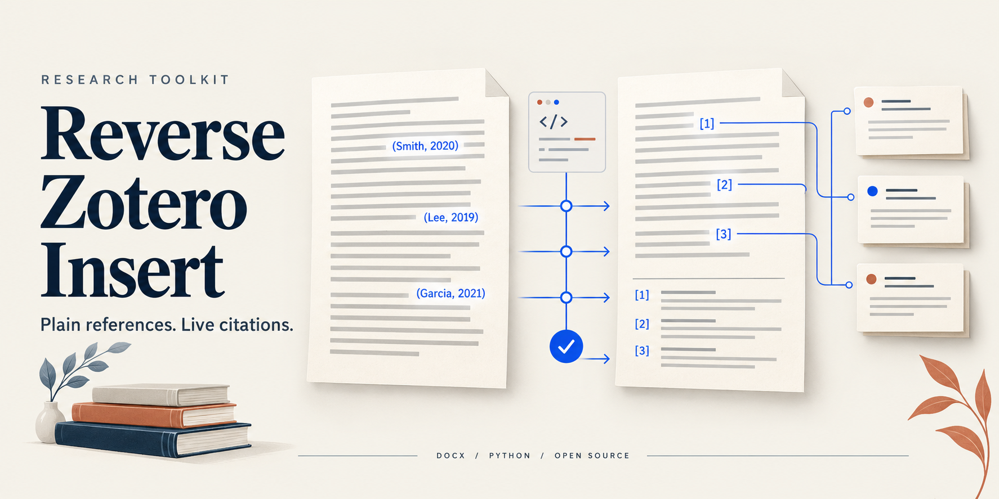
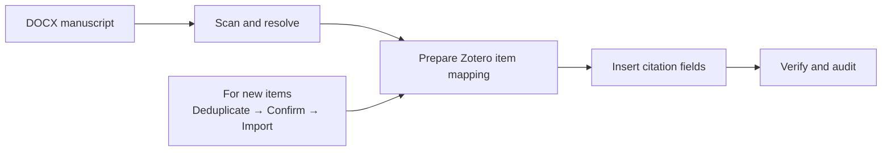

<p align="center"><strong>English</strong> · <a href="README.md">简体中文</a></p>

<p align="center">
  
</p>

<h1 align="center">Reconnect your manuscript to Zotero</h1>

<p align="center">
  Turn plain-text citations in DOCX files into Zotero-readable fields.<br>
  Built for command-line tools, automation, and AI agent workflows.
</p>

<p align="center">
  <a href="#quick-start"></a>
  <a href="LICENSE"></a>
  <a href="https://github.com/hmbbjack/reverse-zotero-insert/archive/refs/heads/main.zip"></a>
  <a href="https://github.com/hmbbjack/reverse-zotero-insert/releases"></a>
</p>

<p align="center">
  <a href="#quick-start">Quick start</a> ·
  <a href="#how-it-works">How it works</a> ·
  <a href="docs/USAGE.en.md">User guide</a> ·
  <a href="SKILL.md">Agent skill (中文)</a> ·
  <a href="docs/DEVELOPMENT.en.md">Development</a>
</p>

---

## Start with the manuscript you already have

Your manuscript is written, but its citations are plain text: `(Smith, 2007)`,
`(doi:10.1000/example)`, or a column of DOIs. You want to link them to Zotero
records without inserting every citation through the Word plugin by hand.

**Reverse Zotero Insert** provides document scanning, reference resolution,
item mapping, field insertion, and output auditing. It works directly on DOCX
files, preserving citation display text while embedding the linked item data.

| Scan the document | Convert citations | Check the result |
| :--- | :--- | :--- |
| Find existing fields, DOI placeholders, and citation columns | Match author–year citations, DOI groups, and explicit text | Detect omissions, duplicate IDs, and incorrect item links |
| Inspect mixed paragraphs and bibliographies | Preserve existing citations and reuse library metadata | Reconcile the output against the source |

<a id="how-it-works"></a>

## How it works



Reuse existing library items when available. Before creating new items, review
the resolved metadata, destination collection, and duplicate handling. The
resulting document can then be opened in Word with Zotero; refresh behavior
must be checked in the target desktop environment.

<a id="quick-start"></a>

## Quick start

**Install.** Requires Python 3.10+. A virtual environment is recommended:

```bash
python -m pip install "https://github.com/hmbbjack/reverse-zotero-insert/archive/refs/heads/main.zip"
```

Alternatively, select **Download ZIP**, extract it, and run `python -m pip install .`.
Installation currently uses GitHub or local packages; this project has not been
published to PyPI.

**Scan first.** This reads the document without modifying it and does not require Zotero:

```bash
reverse-zotero-insert scan manuscript.docx --json
```

**Convert with a mapping.** Prepare real Zotero item keys and identify the body
and bibliography paragraph ranges, then follow the [user guide](docs/USAGE.en.md#convert-and-verify).
The installed Python modules are available as:

```python
from reverse_zotero_insert import docx_audit, reference_ingest, zotero_field_insert

report = docx_audit.scan_document("manuscript.docx", verbose=False)
```

**Audit the output.** Reconcile pure DOI groups, and use `verify(..., deep=True)`
for the broader document checks:

```bash
reverse-zotero-insert audit manuscript.docx manuscript_zotero.docx item_mapping.json
```

> `audit` exit codes: `0` no discrepancies · `1` reconciliation failed · `2` invalid arguments or files. Write conversions to a new file and keep the original as a backup.

<a id="zotero-setup"></a>

## Connect your Zotero library

Offline scanning, conversion, and tests need only the Python dependencies.
Online metadata lookup needs access to CrossRef/PubMed. Reading or writing a
real library also requires:

1. [Zotero 7+](https://www.zotero.org/), running on your machine.
2. The [cookjohn/zotero-mcp](https://github.com/cookjohn/zotero-mcp/releases) desktop plugin, with its MCP service enabled.
3. Your actual Zotero user identity and a reachable service address.

| Setting | Purpose |
| :--- | :--- |
| `ZOTERO_USER_ID` | Zotero user ID; can be inferred from a local Zotero database |
| `ZOTERO_MCP_URL` | MCP endpoint; defaults to `http://127.0.0.1:23120/mcp` |
| `ZOTERO_URI_PREFIX` | Optional custom item URI prefix |
| `CROSSREF_MAILTO` / `NCBI_API_KEY` | Optional contact email and API key for metadata providers |

See the [configuration guide](docs/USAGE.en.md#configuration). In a cloud
workspace, `127.0.0.1` refers to the cloud machine; reaching desktop Zotero
requires a connection accessible from that workspace.

## Supported workflows

| Scenario | Support |
| :--- | :--- |
| English and Chinese author–year citations | Body-text matching and field insertion |
| DOI groups, including legacy DOIs with parentheses | Shared parsing rules across the pipeline |
| Citation columns in tables | Replace DOI cells or write into a selected reference column |
| Existing Zotero fields mixed with plain text | Preserve existing fields and convert matching text |
| Explicit citations without a DOI | Supply a `citation_text_map` |
| Conflicting citation IDs or obsolete item keys | Renumber and relink, with `--dry-run` support |

Headers, footers, footnotes, endnotes, and complex tracked changes are outside
the current body-conversion scope. Citations crossing hyperlinks, bookmarks,
or embedded objects may need extra handling. See [known limits](docs/DEVELOPMENT.en.md#known-limits).

## Development and releases

```bash
python -m pip install ".[dev]"
python -m unittest discover -s tests -v
ruff check .
```

**v3.1** fixes missed citations, lost tabs and line breaks, audit exit codes,
DOI truncation, renumbering, and MCP error handling. It also adds standard Python
packaging and ZIP release automation.

- [Changelog](docs/CHANGELOG.en.md): what changed.
- [Development and publishing](docs/DEVELOPMENT.en.md): build a wheel, source archive, and ZIP.
- [Issues](https://github.com/hmbbjack/reverse-zotero-insert/issues): report a bug or suggest an improvement.

<details>
<summary>Project structure</summary>

```text
reverse-zotero-insert/
├── reference_ingest.py      # Resolution, deduplication, import, and mapping
├── zotero_field_insert.py   # Matching, field generation, and verification
├── docx_audit.py            # Scanning, reconciliation, and repair
├── zotero_mcp.py            # MCP client
├── doi_utils.py             # Shared DOI rules
├── docx_io.py               # DOCX reading and atomic output
├── docs/                   # Usage, development, and release notes
└── tests/                  # Offline regressions and MCP protocol tests
```

</details>

<details>
<summary>Maintenance</summary>

The maintainer balances academic and research commitments. Small releases are
infrequent; larger updates are made as time permits.

</details>

---

[MIT License](LICENSE) · Thanks to [cookjohn/zotero-mcp](https://github.com/cookjohn/zotero-mcp)
for the MCP plugin. This project is not affiliated with Zotero, Microsoft, or the plugin's author.
