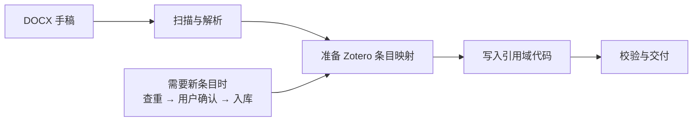

<p align="center"><a href="README.en.md">English</a> · <strong>简体中文</strong></p>

<p align="center">
  
</p>

<h1 align="center">让论文里的引用，重新连接 Zotero</h1>

<p align="center">
  把 DOCX 中的纯文本引用，转换为 Zotero 可识别的域代码。<br>
  为命令行、自动化流程与 AI agent 工作流而设计。
</p>

<p align="center">
  <a href="#quick-start"></a>
  <a href="LICENSE"></a>
  <a href="https://github.com/hmbbjack/reverse-zotero-insert/archive/refs/heads/main.zip"></a>
  <a href="https://github.com/hmbbjack/reverse-zotero-insert/releases"></a>
</p>

<p align="center">
  <a href="#quick-start">开始使用</a> ·
  <a href="#how-it-works">工作原理</a> ·
  <a href="docs/USAGE.md">使用指南</a> ·
  <a href="SKILL.md">Agent Skill</a> ·
  <a href="docs/DEVELOPMENT.md">开发与发布</a>
</p>

---

## 从一份已有的手稿开始

论文已经写好，正文里却只有 `(Smith, 2007)`、`(doi:10.1000/example)` 这样的纯文本引用。
你希望把它们关联到 Zotero 条目，继续管理和刷新，又无法逐条操作 Word 插件。

**Reverse Zotero Insert** 提供扫描、文献解析、条目映射、域代码插入和交付审计。它直接处理 DOCX 文件，保留引用的显示文本，并把 Zotero 条目信息写入文档。

| 扫描文档 | 转换引用 | 核对结果 |
| :--- | :--- | :--- |
| 找出既有域、DOI 占位和表格引文列 | 支持作者年份、DOI 组与指定文本 | 检查遗漏、重复编号和条目指向 |
| 看清混合段落和文献表结构 | 保留既有引用，复用库内元数据 | 对照原稿，逐组核对输出 |

<a id="how-it-works"></a>

## 工作原理



已有 Zotero 条目可以直接复用；需要新增条目时，先展示解析结果、确认目标文件夹与重复条目的处置，再执行导入。输出文件可交给 Word/Zotero 继续处理，刷新效果需在目标桌面环境验证。

<a id="quick-start"></a>

## 开始使用

**安装。** Python 3.10+，推荐在虚拟环境中使用：

```bash
python -m pip install "https://github.com/hmbbjack/reverse-zotero-insert/archive/refs/heads/main.zip"
```

也可以点击顶部 **Download ZIP**，解压后运行 `python -m pip install .`。
安装来源为 GitHub 或本地包，目前尚未发布到 PyPI。

**先扫描。** 这一步不会修改文档，也不需要运行 Zotero：

```bash
reverse-zotero-insert scan 论文.docx --json
```

**再转换。** 准备真实 Zotero 条目映射、确认正文与参考文献段落范围后，按[使用指南](docs/USAGE.md#转换与校验)调用转换函数。安装后的 Python 入口为：

```python
from reverse_zotero_insert import docx_audit, reference_ingest, zotero_field_insert

report = docx_audit.scan_document("论文.docx", verbose=False)
```

**最后核对。** 对纯 DOI 括号组执行逐组审计，并结合 `verify(..., deep=True)` 完成整体检查：

```bash
reverse-zotero-insert audit 论文.docx 论文_zotero.docx item_mapping.json
```

> `audit` 退出码：`0` 无异常 · `1` 对账失败 · `2` 参数或文件错误。转换建议写入新文件，并保留原稿备份。

<a id="zotero-setup"></a>

## 连接你的 Zotero

离线扫描、转换和测试只需 Python 依赖。解析在线元数据需要访问 CrossRef/PubMed；读取或写入真实文献库，还需要：

1. 安装并运行 [Zotero 7+](https://www.zotero.org/)。
2. 安装 [cookjohn/zotero-mcp](https://github.com/cookjohn/zotero-mcp/releases) 的桌面插件，启用 MCP 服务。
3. 配置实际的 Zotero 用户标识与服务地址。

| 配置项 | 用途 |
| :--- | :--- |
| `ZOTERO_USER_ID` | Zotero 用户 ID；有本地数据库时可自动推导 |
| `ZOTERO_MCP_URL` | MCP 地址，默认 `http://127.0.0.1:23120/mcp` |
| `ZOTERO_URI_PREFIX` | 可选，指定条目 URI 前缀 |
| `CROSSREF_MAILTO` / `NCBI_API_KEY` | 可选，元数据服务的联系邮箱与 API key |

完整配置见[使用指南](docs/USAGE.md#配置)。云环境中的 `127.0.0.1` 指向云机器；连接桌面 Zotero 时需要配置云端可达的地址。

## 能处理哪些引用？

| 场景 | 支持方式 |
| :--- | :--- |
| 英文、中文作者年份引用 | 正文匹配与域代码插入 |
| DOI 括号组、含括号的旧式 DOI | 共享解析规则，避免截断 |
| 表格中的 DOI 引文列 | 整格处理或写入指定引用列 |
| 已有 Zotero 域与纯文本混排 | 保留已有域，转换匹配的纯文本 |
| 无 DOI 的指定文本引用 | 通过 `citation_text_map` 提供映射 |
| 已有 citationID 冲突、失效条目 key | 重编号与重链接，支持 `--dry-run` |

页眉、页脚、脚注、尾注和复杂修订内容不在当前正文转换范围内。跨超链接、书签或对象边界的引用需要额外检查；更多说明见[已知范围](docs/DEVELOPMENT.md#已知范围)。

## 开发与版本

```bash
python -m pip install ".[dev]"
python -m unittest discover -s tests -v
ruff check .
```

**v3.1** 修复了引用漏检、换行与制表符丢失、审计退出码、DOI 截断、重编号和 MCP 错误处理，并增加标准 Python 包与发布流程。

- [版本记录](docs/CHANGELOG.md)：查看改进内容。
- [开发与发布](docs/DEVELOPMENT.md)：构建 wheel、源码包和 ZIP。
- [问题反馈](https://github.com/hmbbjack/reverse-zotero-insert/issues)：报告缺陷或提出需求。

<details>
<summary>项目结构</summary>

```text
reverse-zotero-insert/
├── reference_ingest.py      # 解析、查重、导入和条目映射
├── zotero_field_insert.py   # 引用匹配、域代码生成和校验
├── docx_audit.py            # 扫描、对账、重编号和重链接
├── zotero_mcp.py            # MCP 客户端
├── doi_utils.py             # 公用 DOI 解析规则
├── docx_io.py               # DOCX 读取与原子写出
├── docs/                   # 使用、开发与版本文档
└── tests/                  # 离线回归与 MCP 协议测试
```

</details>

<details>
<summary>维护说明</summary>

本人同时存在学业压力和科研压力，因时间原因，几乎不做小版本更新，只在想起来的时候做大版本更新。

</details>

---

[MIT License](LICENSE) · 感谢 [cookjohn/zotero-mcp](https://github.com/cookjohn/zotero-mcp) 提供 MCP 插件。本项目与 Zotero、Microsoft 及该插件作者无隶属关系。
